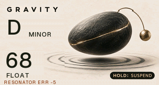

# Gravity 0.2.1

吉他激发调谐共振，FLOAT 控制金属到玻璃般的尾音。

先安装下表的配套算法包，再安装 App。

| 文件 | 版本 |
| --- | --- |
| [App.rpk](App.rpk) | Gravity 0.2.1 |
| [Audio-Pack.rpk](Audio-Pack.rpk) | Gravity Resonator 0.1.1 |

[套件说明](套件说明.md) · [App 源码](source/) · [配套算法源码](source/dsp/) · [版本和校验值](manifest.json) · [社区发布文案](社区发布文案.md) · [开机动画预览](开机动画.gif)
