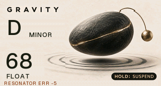

# Gravity

吉他一响，就会带出按调性排列的共振尾音。按住 SUSPEND，可以让那段余音多留一会儿。

## 配套音频包

先安装音频包，再安装 App。

- Gravity Resonator `org.resona.demo.gravity.resonator` 0.1.1

## 两个编码器

| 页面／模式 | 上方旋转 | 上方短按 | 上方长按 | 下方旋转 | 下方短按 | 下方长按／按住 |
| --- | --- | --- | --- | --- | --- | --- |
| Gravity | 选 C～B 调 | 小调／大调 | 重置为 D 小调、FLOAT 68，并重试音频包 | 调 FLOAT 0～100 | 干声对比开／关 | 按住 SUSPEND 延长共振，松开恢复 |

## 项目详细说明

# Gravity

Your guitar excites six tuned resonances in a chosen key. FLOAT moves them from short metallic rings to long,
glass-like tails; holding the big knob suspends them in the air while your new notes come through dry. Nothing
sounds without input. The sound is the nested `dsp/` pack (**Gravity Resonator**); the App builds its own
Guitar -> Gravity Resonator -> Output graph and drives it.

The pack must be installed in the Box's library first. Until it is, the App shows **INSTALL GRAVITY RESONATOR** and
retries once a second.

## Controls

| Control | Turn | Click | Long press / hold |
|---|---|---|---|
| SELECTOR (top) | key C to B | minor / major | reset to D minor, FLOAT 68; retry the pack |
| CUSTOMIZE (big) | FLOAT 0 to 100 (2 per detent) | DRY: compare with the guitar, level-matched within about 1.5 dB | hold: SUSPEND; release returns to normal decay |

Key, FLOAT, DRY, MIX and LEVEL are saved 1.2 s after the last change; SUSPEND is not saved.

If the OS bypasses the DSP for its CPU budget, the App shows **CPU LIMIT**, drops its graph and rebuilds it after
2 s, then 10 s, then 30 s while trips keep coming.

## The screen

The artwork from `assets/gravity-reference.png` with a floating stone that bobs more as FLOAT rises and settles a
little while suspended. On the left: the key and MINOR / MAJOR, then the FLOAT value (DRY while comparing).
SUSPENDED shows bottom right while held.

## Controller

Web (`controller/web/`), Mobile (`controller/mobile/`) and any MIDI controller play Gravity: one CC per control on
channel 1, and CC 119 asks the App for every value. Page PLAY has four hold pads and a Float × Mix pad; pages KEY and
MIX have every setting. The pads override the settings only while held.

| CC | Control | Values |
| --- | --- | --- |
| 20 | Key | 0–11 = C–B |
| 21 | Voicing | 0 minor, 1 major |
| 22 | Float | 0–127 = 0–100 |
| 23 | Mix | 0–127 = 0–100 (default 65) |
| 24 | Level | 0–127 = 0–100 (default 82) |
| 25 | Dry compare | 0 off, 1 on |
| 30 | HOLD pad | 127 suspends, 0 releases (like holding the big encoder) |
| 31 | SOAR pad | 127: FLOAT 100 while held |
| 32 | SINK pad | 127: FLOAT 0 while held (SOAR wins) |
| 33 | FLIP pad | 127: the other of minor/major while held |
| 116 / 117 | Input / output meter | sent by the App to a port that sent CC 119 |
| 119 | Query | any value: the App answers with every value |

### Bench control (bench builds only)

Only in a build with `-DRESONA_DEMO_BENCH` (also the screen-capture SysEx); a normal build ignores these. USB MIDI
**channel 16** CCs call the same handlers as the knobs:

| CC | Meaning |
| --- | --- |
| 20 / 21 | Top / big turn; value is 64 + signed detents |
| 22 / 23 | Top / big raw key; 127 press, 0 release |
| 24 / 25 | Top / big click; any nonzero value |
| 26 / 27 | Top / big long gesture; any nonzero value |

CC 27 can start SUSPEND without a raw press; CC 23 = 0 releases it.

## DSP: Gravity Resonator

    input -> DC removal -> six resonators (root, third, fifth, upper octaves of KEY), decay set by FLOAT
          SUSPEND: the resonators stop decaying and take no new input
          -> MIX with the dry guitar -> LEVEL -> soft limiter

No oscillators and no delay buffers: every tone comes from the guitar's own energy. Below MIX 65 the dry path gains
make-up, so DRY (MIX 0) matches FLOAT's loudness. Mono.

| Parameter | Range | Set by the App |
|---|---|---|
| KEY | 0 to 23: 0–11 C–B minor, 12–23 C–B major | top turn and click (default 2, D minor); FLIP pad |
| FLOAT | 0 to 100 % | big turn (default 68); SOAR / SINK pads |
| SUSPEND | 0 / 1 | big hold, or the HOLD pad |
| MIX | 0 to 100 % | 65, or the controller; 0 while DRY |
| LEVEL | 0 to 100 % | 82, or the controller |

## Build

    resona-lab check dsp
    resona-lab pack build dsp
    resona-lab pack install dsp/build/*.rpk     # the Box's library: no preset slot is written
    resona-lab app build .
    resona-lab app install .
    python3 tools/encode_assets.py              # regenerate src/art.h (Pillow; --font <file.ttf> for another font)
    python3 tools/test_dsp.py                   # host tests of the built pack (NumPy)

`src/art_words.h` holds the packed background used at runtime. The font (`assets/Geist-Medium.ttf`) is only an input
to `tools/encode_assets.py` and is not linked.

MIT, see LICENSE. Geist is under the SIL Open Font License, see `assets/Geist-OFL.txt`.

## 开机动画

悬石从同心波纹上抬起，金色小球沿弧线摆动。 首次运行时保存到 Resona Box，下次开机播放。
